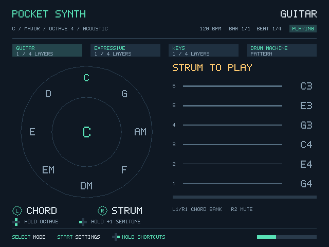

# Pocket Synth

English | [简体中文](README.zh-CN.md)

Turn a handheld or game controller into a pocket-sized musical instrument. Play guitar, flute, violin, piano, electric piano and electronic drums, then build a song with four synchronized Loop tracks.

Pocket Synth runs as a native PortMaster app on the R36S and as a desktop app on macOS. Connect a controller on your Mac to explore sounds and practice the same controls you use on the handheld.

[Download the latest release](https://github.com/FrostMiKu/pocket-synth/releases/latest) for **PortMaster (ARM64)** or **macOS (Apple Silicon)**.



## Instruments

| Mode | Sounds | How to play |
| --- | --- | --- |
| **Guitar** | Acoustic guitar | Choose a chord with the left stick; strum up or down with the right stick. L1/R1 switches chord banks; R2 mutes the strings. |
| **Expressive** | Flute, violin | Choose a note with the right stick and hold L1 to play. Use the left stick for tone and vibrato. Choose a scale wheel or continuous pitch in settings. |
| **Keys** | Piano, electric piano | Play eight scale notes with A, B, X, Y, L1, L2, R1 and R2. Hold several buttons for chords; use the left stick for pitch bend and vibrato. |
| **Drum Machine** | Eight electronic drum pads | Play kick, snare, hats, clap, toms and crash. Move the left stick vertically for dynamics and horizontally for brightness. |

Hold **D-pad right**, then press **L2/R2** to select the previous/next sound. Each mode remembers its selection. Held notes keep their original sound; new notes use the new selection. Recorded tracks keep the sounds you played.

## Quick start

1. **Select** changes instrument. **Start** opens settings.
2. Play a few notes, then hold **D-pad right + B** to record. The first recording starts after a four-beat count-in.
3. Play for one loop. Recording finishes automatically at the end of the loop.
4. Switch instrument and record another track, or record again to add a layer.
5. **Select + Start** exits and saves your settings and Loop.

Hold D-pad right first to display the available shortcuts:

| Right + | Action |
| --- | --- |
| A | Play / pause all tracks |
| B | Start recording, cancel a wait, or finish the current take |
| X | Undo the current track's last take, or cancel its active recording |
| Y, hold for one second | Clear the current track; release early to cancel |
| L1 / R1 | Decrease / increase tempo |
| L2 / R2 | Previous / next sound |
| D-pad up / down | Increase / decrease the fixed octave |

For pitched instruments, hold **D-pad up/down** for a temporary octave change or **D-pad left** to raise notes by one semitone. Each new note captures the current octave and semitone. Held notes and release tails keep that pitch when the modifier changes. Expressive keeps its starting register until you release L1 or center the stick; moving the right stick still changes the melody.

Loop supports one or two bars, overdubbing, undo, quantization and four independent tracks. Pitched tracks support four layers each. Bar and beat indicators follow playback, and tails continue into the next loop. Reopened performances start paused; wait for preparation to finish, then press right + A to play.

Settings include root, scale, octave, volume, note names or numbered notation, and an A/B–X/Y swap option for different controller layouts. The on-screen hints follow your chosen layout. See the [detailed playing guide (Chinese)](docs/快速上手.md) for the full controls.

## Install on a handheld

Use an **ARM64 PortMaster package** built from this project. The R36S is the tested handheld target.

1. Extract `pocketsynth.zip` into your device's `ports` directory.
2. Keep `Pocket Synth.sh` and the `pocketsynth` folder together in that directory.
3. Launch **Pocket Synth** from the Ports menu.

PortMaster provides the controller setup and launch environment. The app needs a 64-bit Linux system with a compatible SDL2 runtime and two analog sticks. The package contains the app and its generated sounds.

## Build on macOS

### Requirements

- A C++17 compiler and the macOS command-line developer tools.
- CMake **3.16+** and Python **3**.
- SDL2 development files, including its CMake package configuration.
- An SDL-compatible game controller for playtesting. Keyboard controls are also available in [input.cpp](src/input.cpp).

Run these commands from the repository root:

```sh
# Configure, compile and run the tests.
scripts/build.sh build-host

# Run directly.
./build-host/pocket-synth
```

To create a Mac app bundle:

```sh
python3 scripts/package-mac.py build-host/pocket-synth dist
open "dist/Pocket Synth.app"
```

The packaging helper bundles the required SDL libraries and licenses, then signs the app locally. It uses `otool`, `install_name_tool` and `codesign` from the developer tools. When SDL2 comes from Homebrew's compatibility package, it also uses Homebrew to locate SDL3.

If CMake cannot locate SDL2, configure its installation prefix explicitly:

```sh
cmake -S . -B build-host -DCMAKE_BUILD_TYPE=Release \
  -DCMAKE_PREFIX_PATH=/path/to/sdl2-prefix
cmake --build build-host --parallel
ctest --test-dir build-host --output-on-failure
```

## Cross-compile for R36S / ARM64

Build on your computer, then transfer the finished app to the handheld.

### Requirements

- CMake, Python 3 and **Zig 0.13.0** on the build computer.
- An **ARM64 SDL2 sysroot** matching the target firmware. It must provide SDL2 headers and an ARM64 `libSDL2.so`:

```text
sysroot/
├── include/SDL2/SDL.h
└── lib/libSDL2.so
```

Set absolute paths to your compiler and sysroot:

```sh
export PS_ZIG=/absolute/path/to/zig
export PS_SYSROOT=/absolute/path/to/sysroot

scripts/cross-build.sh build-aarch64
python3 scripts/package.py build-aarch64/pocket-synth release
```

The build targets `aarch64-linux-gnu` with a glibc 2.28 baseline. Packaging produces:

- `release/pocketsynth.zip` — the manual-install package.
- `release/portmaster/pocketsynth/` — the generated PortMaster submission directory.

Extract the zip into `ports` to install manually. For a device with SSH access, the install helper can run the device tests and install the package:

```sh
scripts/install.sh release/pocketsynth.zip build-aarch64 root@handheld
```

Replace `root@handheld` with your device's SSH address. The helper verifies the executable, runs the device checks, then installs into this app's own directory while preserving its settings and recordings.

## Tests and audio previews

```sh
ctest --test-dir build-host --output-on-failure

# Export the melodic sounds in catalog order.
./build-host/pocket-synth --render-sounds sounds.wav

# Export a four-track performance.
./build-host/pocket-synth --render-loop-demo loop.wav
```

The current sound preview plays flute, violin, piano and electric piano for four seconds each. See the [validation summary](docs/验收报告.md) for tested scenarios and R36S performance measurements.

## Development and license

The sound catalog drives sound selection, display and recording. New presets using an existing model can be added as catalog entries. See the [architecture](docs/architecture.md) and [sound extension guide (Chinese)](docs/音色扩展.md).

Pocket Synth is licensed under the [MIT License](LICENSE). Bundled third-party components retain their licenses in [vendor](vendor/); the DaisySP revision and local adaptations are documented in [UPSTREAM.md](vendor/DaisySP/UPSTREAM.md).
