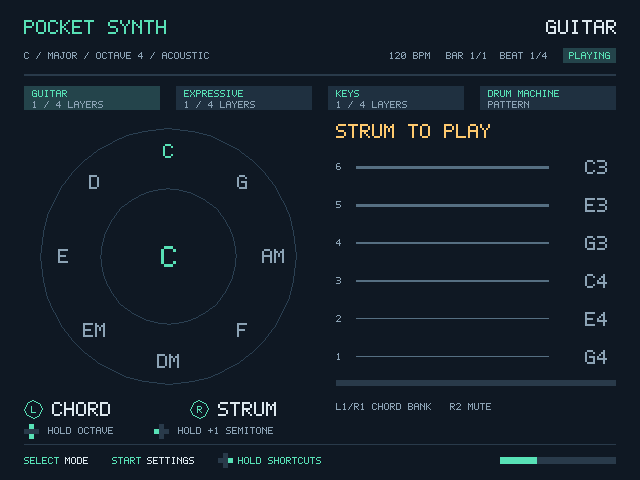

# Pocket Synth

[English](README.md) | 简体中文

把掌机或游戏手柄变成随身乐器。演奏吉他、长笛、小提琴、钢琴、电钢琴和电子鼓，再通过四条同步的 Loop 轨道组合成一段音乐。

Pocket Synth 可以作为原生 PortMaster 应用在 R36S 上运行，也可以在 macOS 上连接手柄演奏和测试，两端使用相同的操作方式。

[下载最新版本](https://github.com/FrostMiKu/pocket-synth/releases/latest)：提供 **PortMaster（ARM64）** 和 **macOS（Apple Silicon）** 安装包。



## 四种乐器模式

| 模式 | 音色 | 演奏方式 |
| --- | --- | --- |
| **Guitar（吉他）** | 原声吉他 | 左摇杆选择和弦，右摇杆上下扫弦。A、B、X、Y、L1、R1 从低音到高音分别拨六根弦；L2 切换和弦组，R2 消音。 |
| **Expressive（表现型）** | 长笛、小提琴 | 右摇杆选音，按住 L1 发声；左摇杆控制音色与揉音。设置中可选择音阶轮或连续音高。 |
| **Keys（键盘）** | 钢琴、电钢琴 | A、B、X、Y、L1、L2、R1、R2 对应八个音阶音，支持同时按键演奏和声；左摇杆控制弯音与揉音。 |
| **Drum Machine（鼓机）** | 八种电子鼓 | 演奏底鼓、军鼓、开闭镲、拍手、通鼓和 Crash；左摇杆上下控制力度，左右控制明亮度。 |

先按住**方向键右**，再按 **L2/R2** 切换上一个／下一个音色。每种模式分别记住音色选择。持续中的音符保留起音时的音色，新音符采用新选择，已录轨道保持录制时的音色。

## 快速开始

1. 按 **Select** 切换乐器，按 **Start** 打开设置。
2. 先试奏几个音，再按住**方向键右＋B** 录制。首次录制会有四拍预备拍。
3. 演奏一轮，录制会在循环结束时自动完成。
4. 切换乐器录制另一轨，或在当前轨道上再次录制以添加一层。
5. 按 **Select＋Start** 退出并保存设置与 Loop。

先按住方向键右，底部会显示当前可用的快捷操作：

| 右方向键＋ | 功能 |
| --- | --- |
| A | 播放／暂停四条轨道 |
| B | 开始录制、取消等待，或结束当前录制 |
| X | 撤销当前轨道上一轮录制，或取消当前录制 |
| Y，按住一秒 | 清空当前轨道；提前松手取消 |
| L1／R1 | 减慢／加快速度 |
| L2／R2 | 上一个／下一个音色 |
| 方向键上／下 | 固定升／降一个八度 |

有音高的乐器共用这些操作：按住**方向键上／下**临时升／降一个八度，按住**方向键左**临时升一个半音。每个音在起音时确定八度与半音；起音后 30 毫秒内补按的修饰键也计入同一次演奏，音高直接切换；修饰键的变化应用于接下来的新音，已有发声与延音保持原音高。Expressive 在松开 L1 或摇杆回中前保持起音时的音区，右摇杆仍可改变旋律音高。

Loop 支持一或两小节、叠录、撤销、量化与四条独立轨道，有音高的轨道每轨支持四层。小节与拍号标记跟随播放，尾音自然延续到下一轮。重新打开已保存的演奏后，等待准备完成，再使用右＋A 播放。

设置中可以调整主音、调式、八度、音量、音名／简谱，以及 A/B、X/Y 交换。操作提示会跟随所选手柄布局。完整说明见[演奏指南](docs/快速上手.md)。

## 在掌机上安装

使用从本项目构建的 **ARM64 PortMaster 安装包**。R36S 是已完成实机验证的掌机型号。

1. 将 `pocketsynth.zip` 解压到掌机的 `ports` 目录。
2. 确认 `Pocket Synth.sh` 和 `pocketsynth` 文件夹位于该目录下。
3. 从 Ports 菜单启动 **Pocket Synth**。

PortMaster 提供手柄配置与启动环境。应用需要具有兼容 SDL2 运行库的 64 位 Linux 系统，以及双模拟摇杆。安装包包含程序与生成的音色。

## 在 macOS 上编译

### 环境要求

- C++17 编译器与 macOS 命令行开发工具。
- **CMake 3.16+**、**Python 3**。
- SDL2 开发文件及其 CMake 包配置。
- 用于试奏的 SDL 兼容手柄；也可以使用 [input.cpp](src/input.cpp) 中定义的键盘映射。

在项目根目录执行：

```sh
# 配置、编译并运行测试。
scripts/build.sh build-host

# 直接运行。
./build-host/pocket-synth
```

生成 Mac 应用：

```sh
python3 scripts/package-mac.py build-host/pocket-synth dist
open "dist/Pocket Synth.app"
```

打包脚本会收集所需的 SDL 动态库和许可证，并进行本地签名。它使用开发工具中的 `otool`、`install_name_tool` 和 `codesign`。如果 SDL2 来自 Homebrew 的兼容包，还会通过 Homebrew 查找 SDL3。

如果 CMake 找不到 SDL2，可以显式指定其安装前缀：

```sh
cmake -S . -B build-host -DCMAKE_BUILD_TYPE=Release \
  -DCMAKE_PREFIX_PATH=/path/to/sdl2-prefix
cmake --build build-host --parallel
ctest --test-dir build-host --output-on-failure
```

## 交叉编译 R36S／ARM64 版本

在电脑上完成编译，再将生成的程序传到掌机。

### 环境要求

- 构建电脑上的 CMake、Python 3 和 **Zig 0.13.0**。
- 与目标固件匹配的 **ARM64 SDL2 sysroot**，包含 SDL2 头文件与 ARM64 的 `libSDL2.so`：

```text
sysroot/
├── include/SDL2/SDL.h
└── lib/libSDL2.so
```

设置编译器和 sysroot 的绝对路径：

```sh
export PS_ZIG=/absolute/path/to/zig
export PS_SYSROOT=/absolute/path/to/sysroot

scripts/cross-build.sh build-aarch64
python3 scripts/package.py build-aarch64/pocket-synth release
```

构建目标为 `aarch64-linux-gnu`，glibc 基线为 2.28。打包后得到：

- `release/pocketsynth.zip`：供手动安装的压缩包。
- `release/portmaster/pocketsynth/`：生成的 PortMaster 提交目录。

将压缩包解压到 `ports` 即可手动安装。掌机已开启 SSH 时，也可以使用安装脚本运行真机测试并安装：

```sh
scripts/install.sh release/pocketsynth.zip build-aarch64 root@handheld
```

将 `root@handheld` 替换为掌机的 SSH 地址。脚本会核对程序、执行真机检查，再安装到当前应用目录，并保留其中的设置与录音。

## 测试与音频试听

```sh
ctest --test-dir build-host --output-on-failure

# 按音色目录顺序导出旋律音色。
./build-host/pocket-synth --render-sounds sounds.wav

# 导出四轨演奏示例。
./build-host/pocket-synth --render-loop-demo loop.wav
```

当前音色试听依次为长笛、小提琴、钢琴和电钢琴，每种四秒。已验证的功能与 R36S 性能数据见[验证摘要](docs/验收报告.md)。

## 开发与许可证

音色目录统一管理音色选择、显示与录音。使用现有发声模型新增音色时，可以直接添加目录条目。进一步说明见[架构文档](docs/architecture.md)与[音色扩展指南](docs/音色扩展.md)。

Pocket Synth 采用 [MIT 许可证](LICENSE)。第三方组件的许可证保留在 [vendor](vendor/) 中；DaisySP 的来源版本与本地调整见 [UPSTREAM.md](vendor/DaisySP/UPSTREAM.md)。
